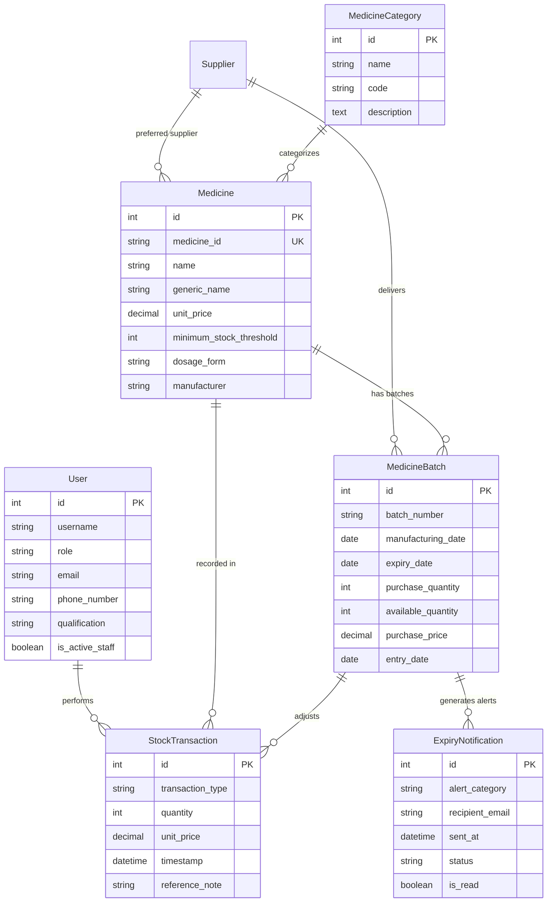

# Smart Medicine Inventory & Expiry Alert System

A modern, web-based pharmacy inventory control and batch-level expiration monitoring platform developed specifically for small pharmacies, medical stores, and healthcare clinics.

---

## 1. Project Overview

Many small pharmacies face stock record discrepancies, unnoticed medicine expiration, financial losses, and critical medicine shortages. The **Smart Medicine Inventory & Expiry Alert System** provides centralized, automated inventory oversight:
- **Batch-Level Tracking**: Each medicine can have multiple independent batches, each with its own manufacturing date, expiry date, purchase price, supplier, and remaining units.
- **Automated Expiry Detection**: Identifies expired medicines and medicines approaching expiry across 4 tiers (Already Expired, &le; 7 Days, &le; 15 Days, &le; 30 Days).
- **Safety Stock Isolation**: Expired medicines are excluded from normal available-stock calculations and quarantined for disposal.
- **Alert Deduplication**: Prevents duplicate email and system alerts for the same alert tier.
- **Low-Stock Shortage Warnings**: Automatically alerts staff when available stock drops below minimum configured thresholds.
- **First-Expiring, First-Out (FEFO) Dispensing**: Prioritizes dispensing from batches nearing expiry.
- **Comprehensive Reporting & CSV Export**: 6 specialized clinical reports with one-click CSV downloads.

---

## 2. Technology Stack

- **Backend**: Python 3.8+, Django 4.2 LTS, Django ORM, Django Authentication
- **Frontend**: HTML5, CSS3, JavaScript, Bootstrap 5.3, Bootstrap Icons, Chart.js
- **Database**:
  - Development: SQLite (default, zero configuration required)
  - Production: MySQL (configured via `DB_ENGINE=mysql`)
- **Email & Alerts**: Django Email Service (Console backend by default; SMTP configurable via environment variables)
- **Architecture**: Modular Django architecture (`accounts`, `inventory`, `suppliers`, `notifications`, `reports`)

---

## 3. User Roles & Access Control

| Role | Access Level | Key Capabilities |
| :--- | :--- | :--- |
| **Administrator** | Full System Access | Dashboard, full Medicine CRUD, Category CRUD, Supplier CRUD, Staff User Management, Expiry Alerts, Audit Logs, All Reports & CSV Exports, Django Admin |
| **Pharmacy Staff** | Inventory Operator | View medicines, Stock In new batches, Dispense medicine (FEFO), Record stock adjustments, View expiry warnings & shortages, Access supplier directory, Generate reports |

### Default Preconfigured Accounts:
- **Administrator**:
  - Username: `admin`
  - Password: `admin123`
- **Pharmacy Staff**:
  - Username: `staff`
  - Password: `staff123`

---

## 4. Key Functional Modules

### A. Dashboard (`/`)
- Dynamic summary statistics: Total Medicines, Usable Available Stock (non-expired), Nearing Expiry (&le; 30d), Already Expired Batches, Stock Shortages, and Registered Suppliers.
- **Chart.js Visualizations**:
  - Doughnut chart for Batch Expiry Status Breakdown (Expired, &le;7d, &le;15d, &le;30d, Safe).
  - Bar chart for Medicine Distribution by Therapeutic Category.
- Top urgent nearing-expiry batches table with instant action buttons.
- Low-stock and out-of-stock shortage list with one-click replenishment.
- Recent stock movements and transaction activity feed.

### B. Medicine Management (`/medicines/`)
- Add, edit, delete, and view medicine details.
- Filter by category, supplier, stock level (In Stock, Low Stock, Out of Stock), and sorting (Name, Price, SKU).
- Tracks SKU, Brand Name, Generic Name, Category, Manufacturer, Unit Selling Price, Minimum Threshold, Dosage Form, Strength, and Storage Conditions.
- Calculates usable stock (non-expired only) vs quarantined expired stock.

### C. Batch & Inventory Management (`/batches/`)
- Batch-wise inventory tracking: batch number, medicine, supplier, manufacturing date, expiry date, purchase quantity, remaining quantity, and unit cost.
- **Stock Dispense (`/medicines/<id>/dispense/`)**: Validates available quantity and enforces FEFO dispensing from valid non-expired batches.
- **Stock Adjustment (`/stock/adjustment/`)**: Audit adjustments for surplus count corrections or damage deductions.
- **Expired Batch Disposal (`/batches/<id>/dispose/`)**: Safe recorded disposal of expired stock with audit reason logging.
- **Movement History (`/stock/transactions/`)**: Full chronological ledger of all stock operations.

### D. Automated Expiry Alert System (`/notifications/`)
- Categorizes batches into 4 alert tiers:
  - **Already Expired**: `expiry_date < today`
  - **Critical**: `expiry_date <= today + 7 days`
  - **Urgent**: `expiry_date <= today + 15 days`
  - **Notice**: `expiry_date <= today + 30 days`
- **Deduplication Engine**: Tracks sent alerts in `ExpiryNotification` model and prevents spamming duplicate notifications for the same alert period.
- **Manual Trigger**: UI button to trigger an on-demand scan across all batches.
- **Management Command**: `python manage.py send_expiry_alerts` for cron jobs or automated schedulers.

### E. Low-Stock Alerts
- Real-time comparison between usable stock and minimum threshold.
- Visible alert pills in top navigation, dashboard table, and dedicated low-stock report.

### F. Supplier Management (`/suppliers/`)
- Add, edit, and deactivate pharmaceutical suppliers.
- Detailed supplier profile showing all supplied medicine batches and active inventory holdings.

### G. Reports & CSV Exports (`/reports/`)
1. **Full Medicine Inventory Report**: Complete catalog with stock, pricing, and supplier info.
2. **Expired Medicines Report**: Quarantined expired batches with calculated financial losses.
3. **Near-Expiry Forecasting Report**: Multi-window filter (7-day, 15-day, 30-day).
4. **Low-Stock & Shortage Report**: Stock deficit calculation for procurement replenishment.
5. **Supplier-wise Inventory Report**: Supplier stock valuation and batch counts.
6. **Stock Movement & Audit Log Report**: Complete history of stock ins, sales, adjustments, and disposals.
- **Direct CSV Downloads**: All 6 reports include one-click CSV export functionality.

---

## 5. Database Schema & Relational Models



---

## 6. Installation & Execution Guide

### Prerequisites
- Python 3.8+ installed
- `pip` package manager

### Step 1: Clone or Navigate to Directory
```bash
cd c:\Users\HP\OneDrive\Desktop\Django
```

### Step 2: Install Dependencies
```bash
pip install django
```

*(Optional dependencies if using MySQL: `pip install mysqlclient` or `pip install pymysql`)*

### Step 3: Run Database Migrations
```bash
python manage.py migrate
```

### Step 4: Populate Demonstration Data
Run the built-in data seeder to create realistic suppliers, categories, medicines, batches (expired, critical, urgent, safe), initial transactions, and users:
```bash
python manage.py seed_data
```

### Step 5: Start the Development Server
```bash
python manage.py runserver
```

Open your browser and navigate to:
**`http://127.0.0.1:8000/`**

Sign in with:
- **Admin**: `admin` / `admin123`
- **Staff**: `staff` / `staff123`

---

## 7. Running Expiry Alerts Command

To run the automated expiry scanner via command line (suitable for cron or Windows Task Scheduler):
```bash
# Scan and send email alerts (prints to console in development)
python manage.py send_expiry_alerts

# Scan and record notifications without sending emails
python manage.py send_expiry_alerts --no-email
```

---

## 8. Running Automated Test Suite

To verify system models, calculations, deduplication, and integration routes:
```bash
python manage.py test
```

All 7 automated tests verify:
- Non-expired stock calculation (isolation of expired batches)
- Low stock trigger detection
- Batch expiry categorization (`EXPIRED`, `CRITICAL_7`, `URGENT_15`, `WARNING_30`, `VALID`)
- Expiry alert deduplication engine
- Role-based route access controls (Administrator vs Staff)
- CSV report generation and HTTP responses

---

## 9. Production Configuration

### Switching to MySQL Database
Set the following environment variables:
```bash
export DB_ENGINE="mysql"
export DB_NAME="pharmacy_db"
export DB_USER="pharmacy_user"
export DB_PASSWORD="secure_password"
export DB_HOST="localhost"
export DB_PORT="3306"
```

### Configuring SMTP Email Delivery
```bash
export DJANGO_EMAIL_BACKEND="django.core.mail.backends.smtp.EmailBackend"
export EMAIL_HOST="smtp.gmail.com"
export EMAIL_PORT="587"
export EMAIL_USE_TLS="True"
export EMAIL_HOST_USER="your-pharmacy-email@gmail.com"
export EMAIL_HOST_PASSWORD="your-app-password"
export ADMIN_ALERT_EMAIL="clinic-director@example.com"
```
